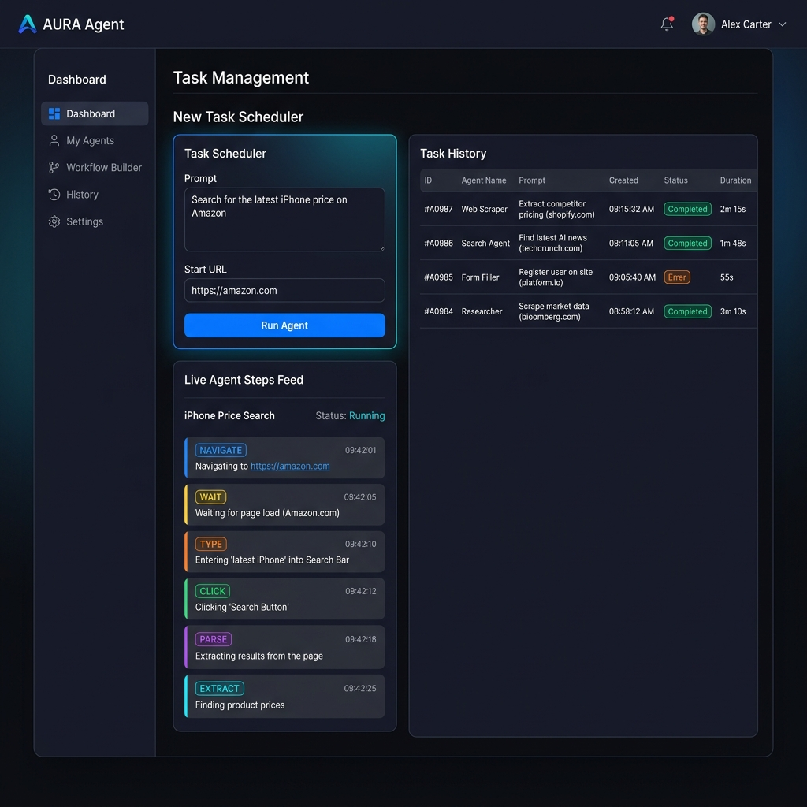

# Autonomous Browser Agent

Autonomous Browser Agent is a Python-based autonomous agent that completes complex web browser tasks step-by-step using LangGraph and Playwright. It streams execution events in real-time to a PostgreSQL database and exposes a FastAPI REST API for task scheduling, progress monitoring, and structured step retrieval.

---

## Demo Placeholder



---

## Tech Stack


---

## Prerequisites

Before starting, ensure you have the following installed:
* **Python 3.11+**
* **Poetry** (recommended) or `pip` / `venv`
* **Docker & Docker Compose**
* An **OpenRouter API Key** (or an OpenAI-compatible API provider key)

---

## Setup & Running

Follow these step-by-step commands to get the browser agent and its API server running locally:

### 1. Clone the Repository
```bash
git clone https://github.com/adityaaa539/Autonomous-browser-agent.git
cd Autonomous-browser-agent
```

### 2. Install Dependencies
Initialize the Python virtual environment and download code dependencies + headless browser binaries:
```bash
# Using Makefile
make install

# Or manually
pip install poetry
poetry install
poetry run playwright install
```

### 3. Configure Environment Variables
Copy the example environment file and fill in your OpenRouter API Key:
```bash
# Windows
copy .env.example .env

# macOS / Linux
cp .env.example .env
```
Inside `.env`, populate your `OPENAI_API_KEY` (and `OPENAI_BASE_URL` if routing through OpenRouter).

### 4. Start the Database Container
Launch the PostgreSQL service in the background:
```bash
# Using Makefile
make db-up

# Or manually
docker-compose up -d
```

### 5. Run Database Migrations
Create the database tables using Alembic:
```bash
# Using Makefile
make migrate

# Or manually
poetry run alembic upgrade head
```

### 6. Run the API Server
Start the development server:
```bash
# Using Makefile
make run

# Or manually
poetry run uvicorn api.main:app --reload
```
The REST API will now be running on [http://localhost:8000](http://localhost:8000). You can access the **interactive Web UI Dashboard** at [http://localhost:8000/ui](http://localhost:8000/ui), and view the interactive API documentation at [http://localhost:8000/docs](http://localhost:8000/docs).

---

## API Endpoints

| Method | Endpoint | Description | Request Body / Params | Response |
| :--- | :--- | :--- | :--- | :--- |
| `GET` | `/` | Root API details and version | None | status JSON |
| `GET` | `/health` | Database connection status health check | None | health JSON |
| `GET` | `/ui` | Serve the interactive HTML dashboard web UI | None | HTMLResponse (HTML page) |
| `POST` | `/tasks` | Create and asynchronously trigger a new browser task | `{"prompt": "str", "start_url": "str"}` | `TaskResponse` (status: `"queued"`) |
| `GET` | `/tasks` | List the last 20 tasks | None | List of `TaskResponse` objects |
| `GET` | `/tasks/{task_id}` | Fetch current task details by UUID | Path: `task_id` (UUID) | Detailed `TaskResponse` |
| `GET` | `/tasks/{task_id}/steps` | Fetch formatted live steps executing for the task | Path: `task_id` (UUID) | JSON steps listing |

---

## API Usage Example

### 1. Submit a Browser Task
Trigger a task requesting the agent to extract the main heading of a web page:
```bash
curl -X POST "http://localhost:8000/tasks" \
     -H "Content-Type: application/json" \
     -d '{"prompt": "Extract the main heading text of this web page.", "start_url": "https://example.com"}'
```

**Response:**
```json
{
  "id": "e9a03b54-7f15-4ba8-8095-207d727b14d2",
  "prompt": "Extract the main heading text of this web page.",
  "start_url": "https://example.com",
  "status": "queued",
  "result_json": null,
  "error": null,
  "step_count": 0,
  "created_at": "2026-06-20T22:30:00Z",
  "updated_at": "2026-06-20T22:30:00Z"
}
```

### 2. Poll for Results
Poll the task details endpoint to see the final result:
```bash
curl -X GET "http://localhost:8000/tasks/e9a03b54-7f15-4ba8-8095-207d727b14d2"
```

**Response (once finished):**
```json
{
  "id": "e9a03b54-7f15-4ba8-8095-207d727b14d2",
  "prompt": "Extract the main heading text of this web page.",
  "start_url": "https://example.com",
  "status": "done",
  "result_json": {
    "result": "Example Domain"
  },
  "error": null,
  "step_count": 1,
  "created_at": "2026-06-20T22:30:00Z",
  "updated_at": "2026-06-20T22:30:15Z"
}
```

### 3. Retrieve Live / Formatted Execution Steps
Get a step-by-step breakdown of exactly what actions the agent performed:
```bash
curl -X GET "http://localhost:8000/tasks/e9a03b54-7f15-4ba8-8095-207d727b14d2/steps"
```

**Response:**
```json
{
  "task_id": "e9a03b54-7f15-4ba8-8095-207d727b14d2",
  "steps": [
    {
      "action": "extract",
      "params": {
        "data": "Example Domain"
      },
      "reasoning": "Extract the main heading element text.",
      "result": "Example Domain"
    }
  ]
}
```

---

## Running Tests
Run the standard unit and end-to-end integration test suites:
```bash
# Run unit tests only
poetry run pytest -m "not e2e"

# Run the complete test suite (includes Playwright E2E browser automation)
poetry run pytest
```
